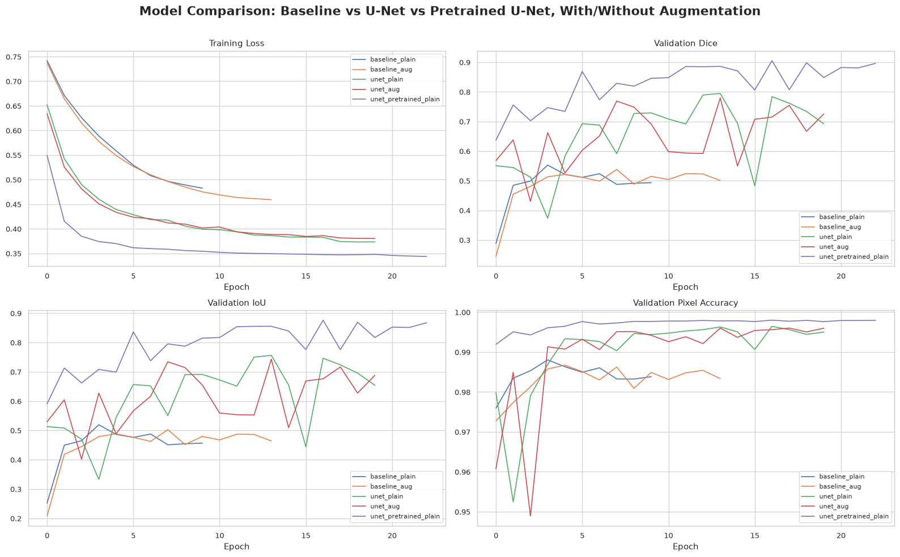
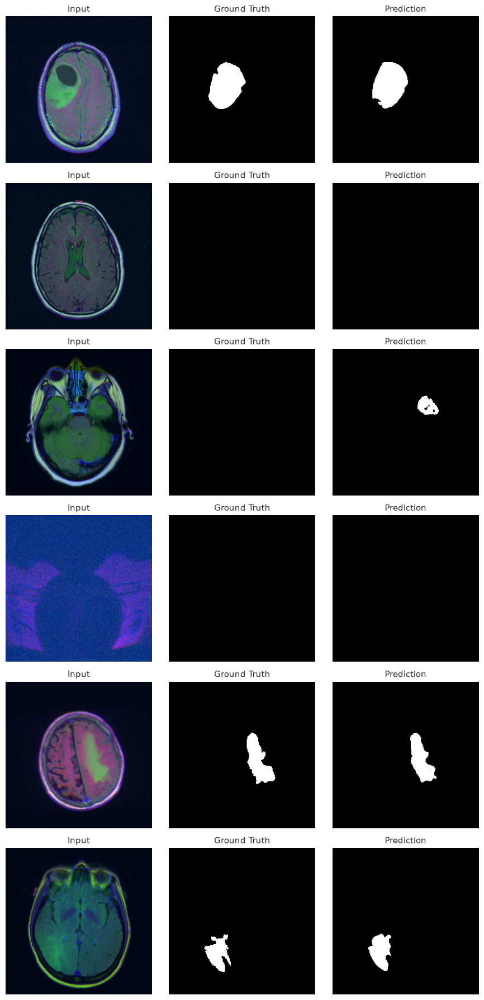
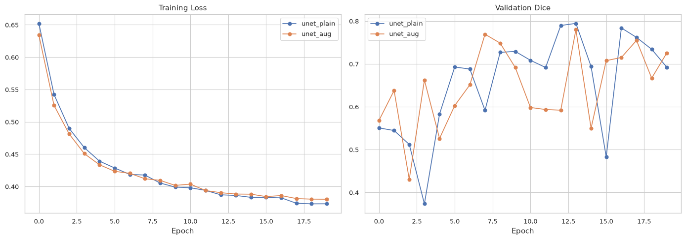

# Brain MRI Tumor Segmentation (CDSS)

Automated brain tumor segmentation on MRI with deep learning. Three architectures are compared,
each trained with and without data augmentation:

| Model | Description |
|---|---|
| **BaselineCNN** | 4-layer fully-convolutional net (lower bound) |
| **U-Net** | Classic U-Net from scratch (64 to 512 channels, 1024 bottleneck, skip connections) |
| **Pretrained U-Net** | U-Net with an ImageNet-pretrained ResNet34 encoder (`segmentation_models_pytorch`) |

Dataset: Kaggle LGG MRI Segmentation, with 110 TCGA patients and 3,929 slices (`.tif` + `_mask.tif`).
See [data/README.md](data/README.md).

## Project structure

```
deep_learning/
├── README.md
├── requirements.txt
├── src/                      # all reusable code
│   ├── config.py             # every setting in one place (+ CLI overrides)
│   ├── data.py               # discovery, split, augmentation, Dataset, loaders
│   ├── models.py             # BaselineCNN, UNet, pretrained U-Net
│   ├── metrics.py            # Dice+BCE loss, metrics, threshold tuning, blob filter, bootstrap CI
│   ├── train.py              # training loop + experiment runner
│   ├── results.py            # merge-safe save/load of results CSV + history JSON
│   ├── plots.py              # comparison / convergence / prediction figures
│   ├── eda.py                # 8-panel EDA dashboard
│   └── utils.py
├── scripts/
│   ├── run_eda.py            # Phase 1: EDA
│   ├── train.py              # main experiments (all 6 models)
│   ├── diagnostics.py        # augmentation diagnostics 1-3
│   └── show_results.py       # print table + redraw plot, no training
├── notebooks/
│   ├── brain_tumor_segmentation.ipynb   # clean notebook, runs the full pipeline
│   └── archive/code_file_original.ipynb # original working notebook (untouched)
├── data/                     # put kaggle_3m/ here
├── results/                  # generated: CSV, JSON, PNGs, checkpoints/
└── docs/
    └── slides/               # figures used in the presentation (slide_05.png ... slide_18.png)
```

## How to run

```bash
pip install -r requirements.txt
# put the dataset at data/kaggle_3m  (or pass --data_dir everywhere)

python scripts/run_eda.py                          # EDA dashboard
python scripts/train.py                            # 5 main experiments (GPU recommended)
python scripts/train.py --only unet_pretrained_aug # 6th model, standalone (as in the original notebook)
python scripts/diagnostics.py                      # convergence, soft-aug run, bootstrap CI
python scripts/show_results.py                     # reprint the results table any time
```

Useful flags (all scripts): `--data_dir`, `--out_dir`, `--epochs`, `--batch_size`, `--limit 200`
(quick test), `--skip_pretrained` (skip the pretrained U-Net if there is no internet).
Results from separate runs are merged into the same CSV/JSON.

Or open `notebooks/brain_tumor_segmentation.ipynb` and run all cells (works on Colab / BHT cluster too).

## Pipeline

1. **EDA**: scan balance (2,556 healthy / 1,373 tumor), tumor size (mean 2.95% of a slice),
   intensity overlap healthy vs tumor, tumor location heatmap.
2. **Preprocessing**: resize 256x256, ImageNet normalization, masks binarized to 0/1.
3. **Augmentation**: CLAHE, ElasticTransform, ShiftScaleRotate, horizontal flip, brightness/contrast.
   Masks use nearest-neighbour interpolation.
4. **Training**: Adam (lr 1e-3, wd 1e-5), Dice+BCE loss (class imbalance), AMP, grad clipping,
   ReduceLROnPlateau, early stopping (patience 6), 25 epochs, batch 64, best checkpoint by val Dice.
5. **Evaluation**: threshold tuned on validation, small-blob removal, test Dice / IoU / precision /
   recall / pixel accuracy.
6. **Diagnostics**: convergence check, softer augmentation with longer training, bootstrap 95% CI.

## Results reported in the slides

Test set, slice-level split (from the original notebook run):

| Model | Dice | IoU | Precision | Recall |
|---|---|---|---|---|
| Baseline CNN | 57.8% | 54.8% | 71.8% | 81.0% |
| Baseline + Aug | 54.7% | 51.6% | 67.8% | 81.6% |
| U-Net | 75.3% | 71.9% | 87.4% | 83.5% |
| U-Net + Aug | 78.5% | 74.9% | 80.3% | 93.3% |
| **Pretrained U-Net** | **90.3%** | **87.5%** | **92.5%** | **94.2%** |
| Pretrained U-Net + Aug | 84.5% | 81.3% | 88.2% | 92.2% |

These numbers come from the original notebook
([notebooks/archive/code_file_original.ipynb](notebooks/archive/code_file_original.ipynb)), which
still contains all training logs and outputs. The code in `src/` is the same code, split into
modules. Training is not fully deterministic (random augmentation, GPU), so a fresh run gives
numbers in the same range but not identical.

### Training curves



### Predictions (Pretrained U-Net, test set)



### Diagnostic: plain vs augmented U-Net convergence



## Limitations

* **Dice on healthy slices.** An empty prediction on a healthy slice scores Dice = 1, and about 65% of
  slices are healthy, so the mean Dice is optimistic.
* **Patient leakage.** The split is done per slice, so slices from the same patient can appear in both
  train and test. `--split_mode patient` splits by patient instead.
